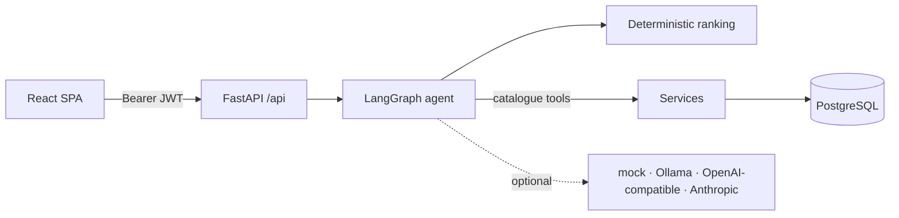

# AgentCart

**An explainable, approval-gated AI shopping assistant.** Describe what you need in plain language. AgentCart extracts your constraints, searches a real product catalogue, filters and ranks with transparent rules, explains every pick and trade-off, and *proposes* cart changes that only happen when you approve them.

> "I need a laptop under ₹70,000 for machine learning and college work, with 16 GB RAM, good battery life, and upgradeable storage."
>
> → **Understood:** Laptops · ≤ ₹70,000 · RAM ≥ 16 GB (required) · Upgradeable storage (required) · Dedicated GPU (preferred) · Long battery life (preferred)
> → **10 laptops** meet every hard requirement (1 more is out of stock and excluded). The top pick, *Lenovo IdeaPad Gaming 3*, is ₹8,010 under budget, has 16 GB RAM ✓, upgradeable storage ✓ and an RTX 3050. Trade-off: weaker battery (6 h vs up to 12 h).
> → "add the top pick to my cart" → **Proposed. Nothing changes until you approve.**

Runs fully locally with **no paid API keys**: the default AI path is a deterministic rule-based parser. Ollama or a hosted model can be plugged in optionally.

---

## Contents

[Features](#features) · [Architecture](#architecture) · [Quick start (Docker)](#quick-start-docker) · [Local development (macOS)](#local-development-macos) · [Environment variables](#environment-variables) · [Local AI models](#local-ai-models-optional) · [Testing & evaluation](#testing--evaluation) · [Verification results](#verification-results) · [Deployment](#deployment) · [Publishing to GitHub](#publishing-to-github) · [Limitations](#limitations--future-work)

## Features

| Area | What you get |
|---|---|
| **Catalogue** | 115 seeded products in 9 categories (laptops, phones, headphones, monitors, tablets, watches, keyboards, mice, speakers) with INR prices, MRP, ratings, stock and typed specs. Keyword search, filters (category, brand, price, rating, stock), sorting, pagination, product pages, 2–4-way comparison. |
| **Agentic workflow** | A typed LangGraph state machine: parse → extract → validate → clarify / search → filter & rank → explain → propose → await approval. Each step is traced with timings and tool calls, has bounded retries, timeouts and an overall deadline, and fails safe. |
| **Grounded recommendations** | Hard constraints are applied before ranking. Deterministic scores for budget fit, spec match, rating (Bayesian-smoothed) and preferences, with configurable weights (env vars or UI sliders). Every product, price and spec comes from the database. No matches → the reason is explained and clearly labelled alternatives are offered. |
| **Safety** | User messages and product descriptions are treated as untrusted. Prompt injection is flagged and has no privileged path to act on. LLM output is grounding-checked. Only two action types exist (`add_to_cart`, `save_preference`), and both need explicit approval. |
| **Memory** | Short-term conversation context ("cheaper ones", "add the second one", "compare the top three") is kept separate from long-term preferences. Preferences are saved only on approval, can be viewed, edited and deleted, and refuse sensitive data. |
| **Cart & checkout** | Server-computed totals, strict quantity validation, row-locked stock checks (no overselling), approval-time price/stock revalidation, quote → explicit confirmation → idempotent demo order. **No real payments.** |
| **Auth** | Argon2id password hashing, JWT bearer tokens, per-user authorization on every resource, CORS from env, rate limits, structured errors. |
| **Frontend** | React 19 + TypeScript. Home, catalogue, product, compare, assistant (with conversation history, ranking sliders, "how I got here" trace), cart, checkout, orders and preferences. Loading, empty and error states; responsive; accessible (labels, focus states, live regions, reduced-motion support). |
| **Quality** | 181 backend tests, 30 frontend unit tests, 7 Playwright E2E tests, and an 81-scenario evaluation suite with metrics. CI for lint, types, tests on PostgreSQL, evaluation thresholds, audits, E2E, Docker builds and secret scanning. |

## Architecture



* **Agent workflow, ranking, data model, key decisions:** [`docs/ARCHITECTURE.md`](docs/ARCHITECTURE.md)
* **Endpoints:** [`docs/API.md`](docs/API.md)
* **Threat model and approval gates:** [`docs/SECURITY.md`](docs/SECURITY.md)

```
backend/     FastAPI app (api, agents, providers, services, models, schemas), Alembic, tests
frontend/    React + Vite + Tailwind SPA, Vitest unit tests, Playwright E2E
evaluation/  81 deterministic scenarios, runner and metrics
docs/        architecture, API, security, deployment, implementation checklist
infra/       index of Docker / hosting / CI files
```

## Quick start (Docker)

Needs Docker Desktop. No other tools are required.

```bash
./scripts/setup-env.sh          # creates .env with random JWT secret + DB password (never committed)
docker compose up --build -d    # PostgreSQL + API (migrates & seeds itself) + nginx frontend
open http://localhost:8080      # register an account, then open "Assistant"
```

| Service | URL |
|---|---|
| App | http://localhost:8080 |
| API | http://localhost:8000/api/health/ready |
| API docs | http://localhost:8000/api/docs (non-production only) |
| PostgreSQL | `localhost:5433` (port chosen to avoid clashing with a local Postgres on 5432) |

Stop with `docker compose down`, or `docker compose down -v` to also delete the database.

## Local development (macOS)

**Prerequisites:**

| Tool | Version | Install |
|---|---|---|
| Python | 3.12+ (developed on 3.14) | `brew install python` |
| Node.js | 20.19+ (developed on 22) | `brew install node` |
| Docker Desktop | — | Used for PostgreSQL |

```bash
# 1. secrets + dependencies
./scripts/setup-env.sh
python3 -m venv backend/.venv
backend/.venv/bin/pip install -r backend/requirements-dev.txt
(cd frontend && npm ci)

# 2. database
docker compose up -d db
(cd backend && .venv/bin/alembic upgrade head && .venv/bin/python -m app.seed)

# 3. run (two terminals)
(cd backend && .venv/bin/uvicorn app.main:app --reload --port 8000)
(cd frontend && npm run dev)     # http://localhost:5173 (proxies /api → :8000)
```

The `Makefile` wraps these steps (`make help`): `make setup`, `make db`, `make migrate`, `make seed`, `make backend`, `make frontend`, `make test`, `make lint`, `make eval`, `make e2e`, `make up`.

**Database commands:**

| Task | Command |
|---|---|
| Migrate | `cd backend && .venv/bin/alembic upgrade head` |
| Seed (idempotent) | `.venv/bin/python -m app.seed` |
| Restore demo prices and stock after test orders | `.venv/bin/python -m app.seed --reset` |
| New migration | `.venv/bin/alembic revision --autogenerate -m "…"` |

## Environment variables

Every variable is documented in [`.env.example`](.env.example). The important ones:

| Variable | Default | Purpose |
|---|---|---|
| `DATABASE_URL` | local Postgres on 5433 | SQLAlchemy URL (`postgresql+psycopg://…`) |
| `JWT_SECRET` | *(generated by `setup-env.sh`)* | ≥ 32 random chars. Required in production. In development, a random ephemeral secret is used if unset. |
| `ENVIRONMENT` | `development` | `production` disables API docs and enforces secrets |
| `CORS_ORIGINS` | `http://localhost:5173,http://localhost:8080` | Allowed browser origins |
| `LLM_PROVIDER` | `mock` | `mock` · `ollama` · `openai_compatible` · `anthropic` |
| `LLM_TIMEOUT_SECONDS` / `LLM_MAX_RETRIES` / `AGENT_DEADLINE_SECONDS` | 20 / 2 / 45 | Bounded AI calls |
| `RANK_WEIGHT_BUDGET` / `_SPEC` / `_RATING` / `_PREFERENCE` | 0.25 / 0.30 / 0.20 / 0.25 | Default ranking weights |
| `MAX_ITEM_QUANTITY`, `SHIPPING_FEE_INR`, `FREE_SHIPPING_THRESHOLD_INR` | 10, 99, 999 | Commerce rules |
| `RATE_LIMIT_*` | 10 / 20 / 60 per minute | Auth (per IP), chat and writes (per user) |
| `VITE_API_BASE_URL` | *(empty = same origin)* | Frontend build-time API URL for split hosting |

## Local AI models (optional)

The default `mock` provider means **no model is needed**: extraction is rule-based and explanations are templated from catalogue data. To let an LLM enrich extraction and polish wording:

| Option | Setup |
|---|---|
| **Ollama on your Mac** | `brew install ollama && ollama serve`, then `ollama pull llama3.2:3b`. Set `LLM_PROVIDER=ollama` and `OLLAMA_BASE_URL=http://localhost:11434` (or, from Docker, `OLLAMA_BASE_URL_DOCKER=http://host.docker.internal:11434`). |
| **Ollama in Compose** | `docker compose --profile ollama up -d`, then `docker compose exec ollama ollama pull llama3.2:3b` and set `LLM_PROVIDER=ollama`. |
| **Hosted, OpenAI-compatible** (Groq, OpenRouter, …) | Set `LLM_PROVIDER=openai_compatible`, `HOSTED_LLM_BASE_URL`, `HOSTED_LLM_API_KEY` and `HOSTED_LLM_MODEL`. May incur costs. |
| **Anthropic** | Set `LLM_PROVIDER=anthropic` and `ANTHROPIC_API_KEY` (model `ANTHROPIC_MODEL`, default `claude-haiku-5-5`). May incur costs. |

`GET /api/health/ready` shows which provider is active. If a configured provider is missing its key, the app falls back to `mock`.

Whatever model you use, it cannot add hard constraints, invent budgets or products, or bypass approvals (see [`docs/SECURITY.md`](docs/SECURITY.md)).

> Not yet verified: the Ollama and hosted-provider paths were tested only with a scripted fake model and mocked HTTP, not against a real model (Ollama isn't installed on the development machine).

## Testing & evaluation

```bash
cd backend && .venv/bin/pytest                    # 181 tests, in-memory SQLite (~5 s)
TEST_DATABASE_URL=postgresql+psycopg://agentcart:<pw>@localhost:5433/agentcart_test .venv/bin/pytest   # same suite on Postgres
cd backend && .venv/bin/ruff check . && .venv/bin/ruff format --check . && .venv/bin/mypy app
backend/.venv/bin/python evaluation/run_eval.py --strict   # 81 scenarios → evaluation/reports/latest.md

cd frontend && npm test && npm run lint && npm run typecheck && npm run build
cd frontend && npx playwright install chromium    # once
cd frontend && npm run e2e                        # needs the stack on :5173 (dev) …
E2E_BASE_URL=http://localhost:8080 npm run e2e    # … or the Docker stack
```

Sign-up and login share a limit of `RATE_LIMIT_AUTH_PER_MINUTE` (default 10) per client IP. Each E2E run registers 3 accounts from your machine, so back-to-back runs can hit it. The E2E sign-up helper then waits for the server's `Retry-After` and resubmits once, so such runs are slower but don't fail. CI's E2E job disables rate limiting.

The **evaluation suite** ([`evaluation/README.md`](evaluation/README.md)) covers:
* budget and spec constraints, ranking, empty results, missing information, out-of-stock;
* prompt injection, unsupported LLM claims, cart approval, invalid quantities;
* stock and price changes, and unauthorized access.

It measures constraint satisfaction against independent ground truth, top-1/top-3 accuracy, invalid-action rate, tool-call success and grounded-card rate. The same thresholds are enforced in `pytest` and CI.

## Verification results

All results below were produced on the development machine (macOS, Python 3.14.4, Node 22.23, Docker 28.3) on 18 Oct 2026.

| Check | Result |
|---|---|
| Backend tests (SQLite) | **181 passed** |
| Backend tests (PostgreSQL 16) | **181 passed**; line coverage **92%** |
| Alembic migration upgrade → downgrade → upgrade → downgrade (PostgreSQL) | ✅ |
| ruff lint + format, mypy (47 source files) | ✅ no issues |
| Evaluation suite | **81/81 scenarios passed**. Constraint satisfaction 100% (92 checks); top-1 100% (12 cases); top-3 100% (5 cases); invalid-action rate 0%; tool-call success 100% (81 calls); grounded cards 100% (172) |
| Frontend unit tests (Vitest) | **30 passed** |
| ESLint, TypeScript (`tsc -b`) | ✅ no errors or warnings |
| Production build | ✅ JS 393 KB (122 KB gzip), CSS 38 KB (8.1 KB gzip) |
| Playwright E2E (desktop + mobile) against Vite dev + local API | **7 passed** |
| Playwright E2E against the **Docker Compose** stack (nginx + CSP) | **7 passed** |
| `docker compose up --build`: db, backend, frontend | ✅ all healthy; backend runs as non-root `app` user |
| `pip-audit` (runtime deps), `npm audit` (all deps) | ✅ 0 known vulnerabilities |

**Not verified:**
* The GitHub Actions workflow has not run yet (there is no remote). Its steps were each run locally.
* Real LLM providers (see above).
* Deployments (none performed).

The evaluation is self-authored; see the caveats in [`evaluation/README.md`](evaluation/README.md).

## Deployment

Configuration is ready for **Vercel** (frontend), **Render** (API container, `render.yaml`) and **Neon** (PostgreSQL). [`docs/DEPLOYMENT.md`](docs/DEPLOYMENT.md) has step-by-step instructions and free-tier caveats: Render free services sleep after inactivity and cold-start slowly, Neon suspends idle compute, and Vercel Hobby is non-commercial only.

**Nothing has been deployed**, and no external resources or accounts have been created.

## Publishing to GitHub

The repository is local only (no remote). When you are ready:

```bash
git status && git log --format='%h %an <%ae> %s'   # confirm the author identity on every commit
git diff --cached                                  # inspect anything staged
git ls-files | grep -E '\.env$|secret|\.pem$'      # must print nothing (only .env.example is tracked)
make lint && make test                             # re-run checks
gh repo create <name> --private --source . --push  # or create the repo on github.com and `git remote add` + `git push -u origin main`
```

After the first push, check the **CI** workflow run, and enable Dependabot alerts and secret scanning in the repository settings.

## Limitations & future work

| Area | Limitation | Possible next step |
|---|---|---|
| **Catalogue data** | Brand names are real, but prices, stock, ratings and some specs are illustrative demo values. There are no product photos (category illustrations instead). | — |
| **Language understanding** | The rule-based parser covers common phrasings (English, Indian budget formats such as "70k" and "1.2 lakh"). Unusual phrasing may need clarification. | An LLM provider broadens coverage but only adds soft hints. |
| **Search** | Keyword search is substring-based (no full-text ranking or embeddings). | PostgreSQL `tsvector` or pgvector semantic search |
| **Infrastructure** | Rate limiting is per process. There is no refresh token, email verification or password reset. | Redis-backed limits; cookie sessions with CSRF protection |
| **Checkout** | Demo only: no payments, addresses, tax breakdown or order cancellation. | — |
| **Agent responses** | Not streamed: the UI shows a "working" indicator until the full answer arrives. | Stream graph node events |
| **Tooling** | `frontend/.npmrc` sets `legacy-peer-deps` to work around an npm 10 resolver crash. `npm run check:peers` (run in CI) verifies all required peers are present. | — |

Further ideas: multilingual input (Hindi/Hinglish), price-drop alerts on saved preferences, a richer evaluation set with human-labelled relevance, and an observability dashboard for agent traces.

---

Built as a portfolio project. Catalogue values are fictional demo data; no real orders or payments are ever made.
