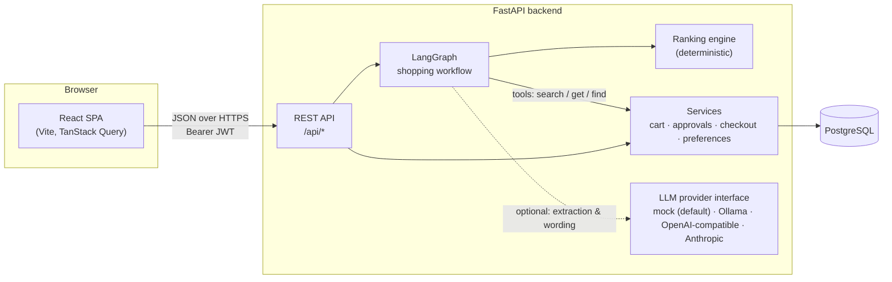
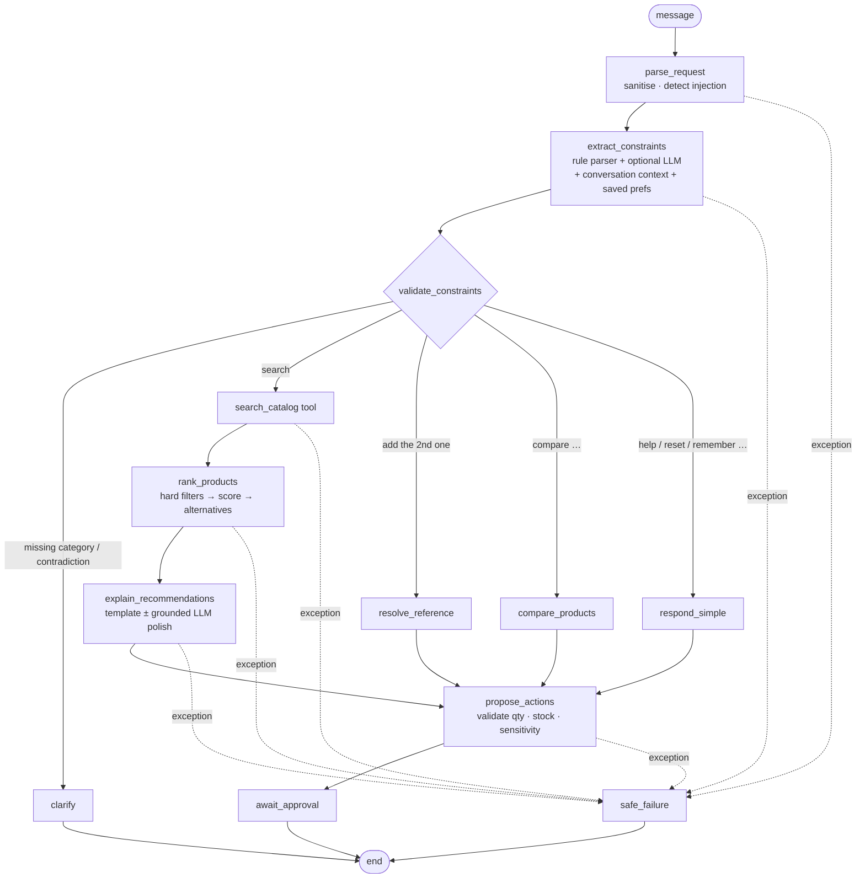
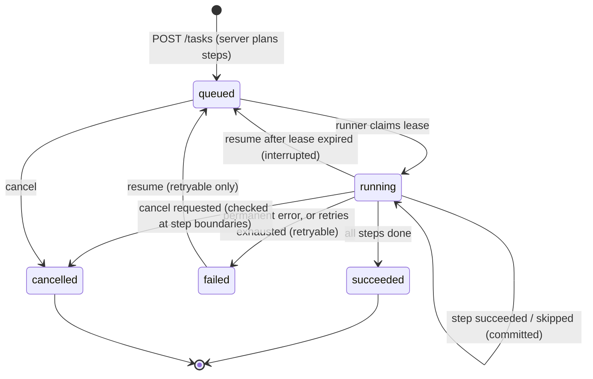
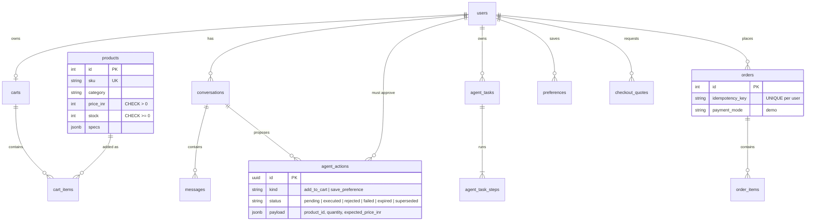
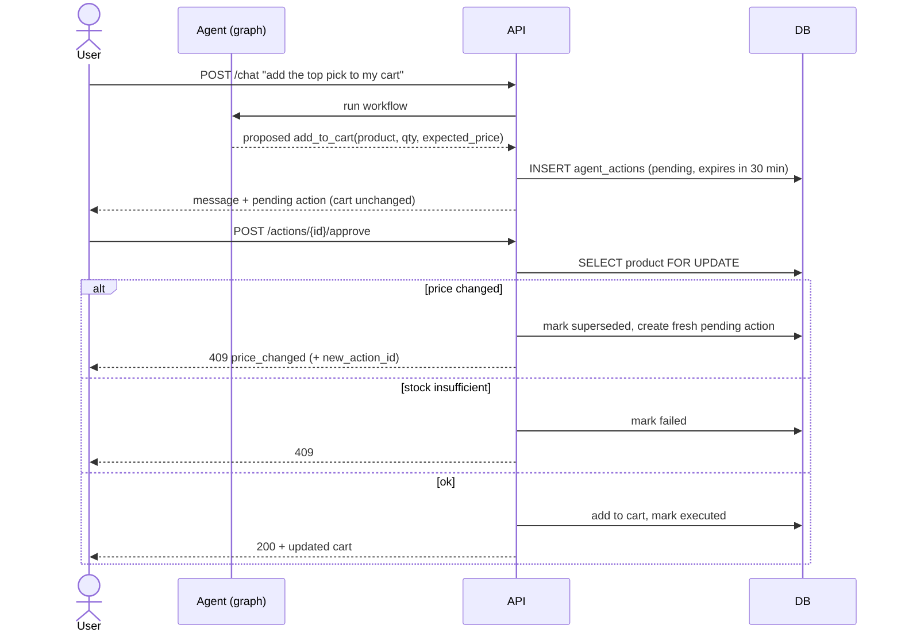

# Architecture

## System overview



* **Frontend** (`frontend/`): a static single-page app. It renders only structured data from the API. It never renders HTML from the server, and it never computes prices or totals.
* **Backend** (`backend/app/`): FastAPI with SQLAlchemy 2.0 on PostgreSQL. Business rules live in `services/`; the agent lives in `agents/`.
* **LLM providers** (`backend/app/providers/`) are optional helpers. The default `mock` provider makes no network calls, so the whole application works without any API key.

## The shopping agent workflow

The workflow is an explicit `StateGraph` (`backend/app/agents/graph.py`). Every node is wrapped with timing, tracing and exception capture. A failing node sends the run to `safe_failure`, which returns an apology and proposes nothing.



| Requirement stage | Where it happens |
|---|---|
| 1. Parse the request | `parse_request`: NFKC normalisation, removal of control, bidi and zero-width characters, 2,000-character cap, injection flags |
| 2. Extract preferences and constraints | `extract_constraints`: `agents/parser.py` (rules), optional `agents/llm_extract.py`, then `memory.merge_with_context` and `memory.apply_saved_preferences` |
| 3. Validate constraints | `validate_constraints`: `agents/validation.py` checks the spec registry, operator/type compatibility, realistic ranges, budget and bound contradictions, and quantity limits |
| 4. Search the catalogue with tools | `search_catalog` → `ToolBox.search_catalog` (traced; transient DB errors retried once) |
| 5. Hard filters, then ranking | `rank_products`: `services/ranking.filter_products` → `rank_products` → `find_alternatives` |
| 6. Grounded explanations and comparisons | `explain_recommendations`, `compare_products`, plus `guardrails.check_grounding` for any LLM text |
| 7. Clarifying questions | `clarify` (blocking), plus non-blocking follow-ups such as "Do you have a budget?" |
| 8. Propose cart actions | `propose_actions` (only `add_to_cart` and `save_preference` exist) |
| 9. Wait for explicit approval | `await_approval` ends the run. Actions are stored as `pending` and executed only by `POST /api/actions/{id}/approve` |
| 10. Revalidate before checkout | `services/actions.approve` re-reads price and stock under a row lock; `services/checkout.confirm` re-checks everything a second time |

**Bounded retries and timeouts.**
* Each provider call has a per-attempt timeout (`LLM_TIMEOUT_SECONDS`) and `LLM_MAX_RETRIES` retries with backoff.
* Each attempt's timeout is clipped to the remaining agent deadline (`AGENT_DEADLINE_SECONDS`), and optional LLM steps are skipped once the deadline has passed.
* Catalogue tools retry once on `OperationalError`.
* LangGraph runs with `recursion_limit=25`.

**Why approvals live outside the graph.** LangGraph's `interrupt()` needs a checkpointer and a resumable thread. Storing proposals as database rows (`agent_actions`) gives the same "pause for a human" semantics with three extra benefits:
* approvals survive restarts;
* they are auditable;
* they are authorised by ordinary per-user checks.

When the user approves, the server re-validates live data rather than trusting what the agent saw.

## Persistent agent tasks



* **Persistence.** `agent_tasks` holds status, progress, input, result, error and the lease; `agent_task_steps` holds each step's status, frozen arguments, output, error and attempt count. Every transition is committed, so a crash loses at most the step in flight.
* **Leases.** A runner claims a task under a row lock (`locked_by`, `locked_until`) and renews the lease at every step. An expired lease marks the task *interrupted*; a runner that finds it has lost its lease stops without writing.
* **No duplicated work.** Finished steps are skipped on resume and their stored output is reused; a step's arguments are frozen when it first starts.
* **Retries.** Transient failures are retried with exponential backoff; permanent failures fail the task immediately.
* **Approval gating.** Steps come only from the server-side planner and run read-only tools via the typed tool registry. Future cart or checkout steps must go through the existing pending-action approval flow.

## Ranking

All ranking is plain Python in `backend/app/services/ranking.py`:

1. **Hard filters.** Category, budget, hard spec constraints, brand include/exclude and in-stock. A product failing any of these is never presented as a match. Out-of-stock matches are reported separately.
2. **Scores (0–1 each).**
   * `budget`: cheaper relative to the budget, or relative to the shortlist when there is no budget.
   * `spec`: soft constraints met, plus headroom over hard minimums.
   * `rating`: a Bayesian-smoothed rating, so a few 5★ reviews don't win.
   * `preference`: soft preferences (for example "long battery") normalised across the shortlist, plus preferred brands.
3. **Weighted sum.** Weights default to 0.25 / 0.30 / 0.20 / 0.25. They can be configured through `RANK_WEIGHT_*` environment variables and overridden per request (the UI exposes sliders). Hints like "cheapest" or "best rated" triple one weight.
4. **Deterministic tie-break.** Score, then price, then id.
5. **Explanations.** Reasons, trade-offs, unmet soft requirements and (for alternatives) violations are all derived from catalogue fields.
6. **No results.** The closest in-stock alternatives are found by counting violated constraints and measuring the relative gap. User-excluded brands are never relaxed.

## Data model



* Money is stored as integer rupees (all catalogue prices are whole rupees), so there is no floating-point arithmetic on totals.
* `conversations.context` is short-term working memory: the last validated intent and the last shown product ids. `preferences` is long-term memory and is only written after the user approves or adds an entry.
* `checkout_quotes` freezes the priced cart. `orders.idempotency_key` makes confirmation safe to retry.

## Approval gate (sequence)



## Key technical decisions

| Decision | Why |
|---|---|
| Rule-based parser as the default extractor | The app works offline and deterministically (which makes it testable), and needs no API key. An LLM can only add soft hints. |
| "Model proposes, code disposes" | LLM-extracted constraints are always soft. A budget from the LLM is accepted only if the number appears in the user's text. Every attribute is checked against `services/specs.py`. |
| No product descriptions in LLM prompts | Descriptions are untrusted catalogue text (one seeded product contains a prompt injection on purpose). Ranking and explanations use structured fields only. |
| Grounding checker on LLM output | Any ₹ amount, rating, URL or non-recommended catalogue product name in LLM text causes it to be rejected in favour of the deterministic template. |
| Synchronous SQLAlchemy with row locks | Simple and correct. `SELECT … FOR UPDATE` on products prevents overselling during approval and checkout. FastAPI runs sync endpoints in a thread pool. |
| JWT bearer tokens (no cookies) | No CSRF surface and simple cross-origin deployment (Vercel + Render). The trade-off (XSS exposure) is handled in `SECURITY.md`. |
| Integer rupees | Exact arithmetic, and it matches the data. |
| SQLite for fast unit tests, PostgreSQL in CI | Same suite on both (`TEST_DATABASE_URL`). `JSONB` falls back to `JSON` via a type variant. |
| Python 3.14, React 19, Vite 7, React Router 7, Tailwind 4 | Current stable lines verified to work together. Brand-new majors (TypeScript 7, ESLint 10, Vite 8, React Router 8) were deliberately not adopted yet. |

## Repository layout

```
backend/
  app/
    api/          FastAPI routers + dependencies (auth, rate limits)
    agents/       LangGraph workflow, parser, validation, memory, guardrails, tools, explanations
    providers/    LLM provider interface + mock / Ollama / OpenAI-compatible / Anthropic
    services/     business logic: catalog, ranking, cart, actions, checkout, preferences, chat, specs
    models/       SQLAlchemy models
    schemas/      Pydantic request/response models
    core/         settings, security, errors, rate limiting
    db/           engine/session, declarative base
    seed/         115-product demo catalogue + idempotent seeder
  alembic/        migrations
  tests/          pytest (unit, integration, evaluation gate)
frontend/
  src/lib         API client, auth, queries, formatting, types
  src/components  layout, design-system primitives, product card, comparison table
  src/features/chat  assistant UI (messages, recommendation & approval cards)
  src/pages       routes
  e2e/            Playwright tests
evaluation/       81 deterministic scenarios + runner + metrics
infra/            notes on where the deployment files live (see infra/README.md)
docs/             architecture, API, security, deployment, checklist
.github/workflows CI
```

The requested layout was kept with two adaptations:
* Dockerfiles sit inside `backend/` and `frontend/` because those directories are their build contexts.
* Hosting manifests sit where each platform expects them: `render.yaml` at the repository root and `vercel.json` in the frontend root.

`infra/README.md` indexes all of them.
